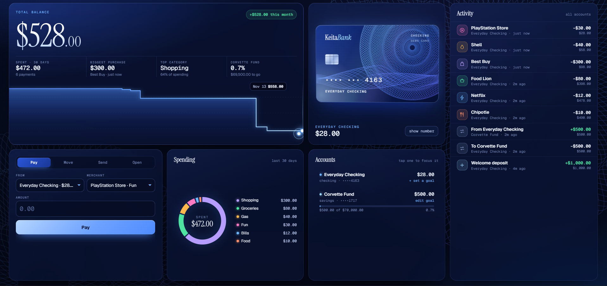
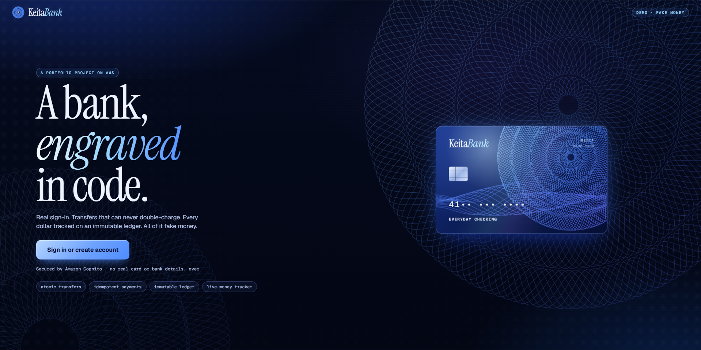
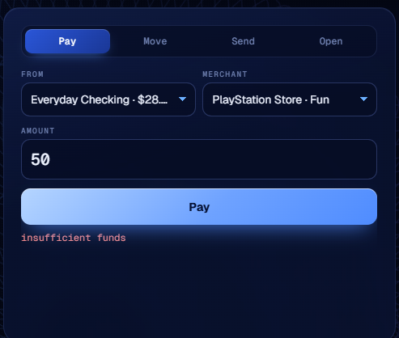
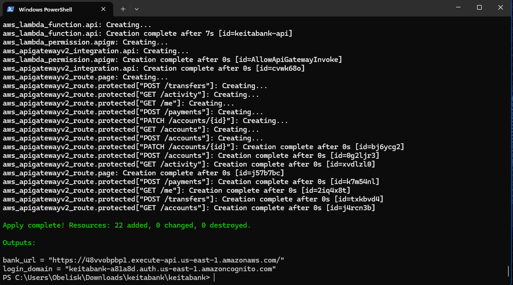

<p align="center">
  
</p>

<p align="center">
  
  
  
  
  
</p>

<p align="center">
  <a href="#-what-it-does">What it does</a> ·
  <a href="#-the-three-rules-of-money">The three rules</a> ·
  <a href="#-how-its-built">How it's built</a> ·
  <a href="#-proving-it">Proving it</a> ·
  <a href="#-what-the-tests-and-checks-caught">What got caught</a> ·
  <a href="#-run-it-yourself">Run it</a>
</p>

---

A bank is the hardest kind of app to get *slightly* wrong. A to-do list that
saves twice shows a duplicate. A bank that saves twice takes someone's rent.

KeitaBank is a small bank built to get that part right: real sign-in, real
accounts with account numbers, transfers between people, card-style payments,
and a ledger that records every cent. The money is fake. The guarantees are
the ones a real bank needs.

This is my fifth AWS project and the first in fintech. It builds on the two
before it — the idempotent card swipes from
[Project 03](https://github.com/ArchitectKeita/aws-fraud-alerts) and the
all-Terraform approach from
[Project 04](https://github.com/ArchitectKeita/aws-job-tracker).



<br>

## ◆ What it does

| | |
|---|---|
| **Sign in** | Email and password through Amazon Cognito's hosted login. New customers get a checking account and $1,000 of demo money. |
| **Accounts** | Open checking or savings accounts, each with its own 10-digit account number. Name them. Set a savings goal and watch the bar fill. |
| **Move** | Transfer between your own accounts. |
| **Send** | Pay another customer by their account number, with a memo. |
| **Add** | Deposit demo money as a paycheck, cash, a refund or a gift — up to $5,000 at a time. |
| **Pay** | Spend at twelve merchants. Each payment is tagged gas, groceries, food, shopping, bills or fun. |
| **Track** | A live balance chart, a spending ring by category, monthly change, biggest purchase, and a feed of every transaction with the balance after it. |



The line-work on the card and behind the page is **guilloche** — the woven
engraving printed on banknotes — drawn by about thirty lines of code rather
than an image file. The three typefaces are embedded in the page, so the bank
loads nothing from any third-party server.

<br>

## ◆ The three rules of money

Everything in the backend exists to keep three promises.

### 1. A payment happens once, no matter how many times it's sent

Phones double-tap. Networks retry. Every payment carries an **idempotency
key** the browser generates once per submit. The key is written to the
database *in the same transaction* as the money. Send the same request again
and the bank returns the original result without moving anything.

### 2. Money moves completely, or not at all

A transfer is four writes: take from one balance, add to another, and one
ledger line for each side. They go to DynamoDB as a single
`TransactWriteItems` call. If any one fails, none of them happen. There is no
moment where the money has left one account and not arrived in the other.

### 3. A balance can never go below zero — even in a race

Each balance update says: *"only do this if the balance is still exactly what
I read, and the result isn't negative."* If two payments race for the same
dollars, the database lets one through and rejects the other, which re-reads
and tries again. No locks, no queue.

And one rule about how numbers are stored: **money is whole cents, always
integers.** `0.1 + 0.2` is not `0.3` in floating point, so a float never
touches a balance — the browser parses `"12.50"` as text into `1250`, and the
API refuses anything that isn't a positive whole number.



<br>

## ◆ How it's built

<p align="center">
  
</p>

| Piece | What it is |
|---|---|
| Cognito user pool | Sign-up, sign-in, email verification. Public client, authorization-code flow with PKCE — no client secret in the browser. |
| HTTP API | API Gateway. A JWT authorizer checks every token's signature, issuer, audience and expiry **before** the Lambda runs. Throttled to 10 requests/second. |
| `keitabank-api` | One Lambda. Serves the page and runs the bank. Never parses a token itself. |
| `keitabank` table | DynamoDB, on-demand, point-in-time recovery on. One table holds everything. |

**One table, five kinds of row:**

| Row | Key | Purpose |
|---|---|---|
| Profile | `USER#<id>` / `PROFILE` | Created on first sign-in |
| Account | `USER#<id>` / `ACCT#<id>` | Balance, nickname, goal, status |
| Ledger line | `USER#<id>` / `TXN#<time>#…` | One per side of every movement. Written once, never edited. |
| Number index | `ACCTNUM#<number>` | Finds an account by its 10-digit number |
| Idempotency key | `IDEM#<id>/<key>` | The stored result of a request already handled |

Because every customer's rows share one partition key, *"show me my accounts
and my last 300 transactions"* is a single query — and one customer's query
can't return another's rows.

**The function's permissions are five actions on one table**, plus its own
logs: `Query`, `GetItem`, `PutItem`, `UpdateItem`, `ConditionCheckItem`. It
can't scan the table, delete from it, or touch anything else in the account.

<br>

## ◆ Proving it

One command built the first 22 resources. (A 23rd, the deposit route, came later as a one-resource apply.)



The first deploy worked on the first try, and the reason is the tests — 45 of them now — that
ran before it. They run the real Lambda code against a mocked DynamoDB:

```
python tests/test_accounts.py     # 14 checks: sign-up, accounts, account numbers, isolation
python tests/test_money.py        # 31 checks: transfers, payments, deposits, races, the books
```

The ones that matter most:

| Test | Result |
|---|---|
| The same transfer sent twice | Money moves **once**; the second call returns the first result |
| Paying more than the balance | Refused, balance untouched |
| Negative, zero, decimal, text and `true` as amounts | All refused |
| Customer B using customer A's account as the source | `404` — A's money untouched |
| Customer B editing A's account | Refused |
| **Five $200 transfers fired at once from a $597.40 account** | **Two succeed. Balance ends at $197.40. Never negative.** |
| Every account's ledger lines added up | Equals the balance, to the cent |
| All the money in the bank, before and after | Changed only by what was paid out to merchants and what was deposited |

The last two are the bank's version of balancing the books: if the ledger and
the balances ever disagree, something is broken.

<br>

## ◆ Design decisions

**API Gateway checks the token, not my code.** The most dangerous code in a
bank is hand-written authentication. Here the managed authorizer rejects a
bad token before the function is even invoked, and the function reads the
customer's ID from claims the gateway already verified.

**Your ID comes from the token, never from the request.** No route accepts
"whose account is this" as input. The only way to name someone else's account
is by its public account number, and only as the *destination* of a transfer.

**The ledger is the truth; the balance is a shortcut.** Each ledger line
stores the balance after it. The balance on the account row could be rebuilt
from the ledger at any time — and the tests check that they agree.

**Refuse, don't fix.** `12.5` cents isn't rounded, a missing idempotency key
isn't generated server-side, an unknown merchant isn't defaulted. A bank that
guesses what you meant is a bank that's sometimes wrong about your money.

**Account numbers are random and reserved atomically.** A new number is
claimed with a conditional write in the same transaction that creates the
account, so two accounts can never share one.

<br>

## ◆ What the tests and checks caught

**A request with the wrong shape crashed the function.** Sending a JSON list
where an object was expected raised an exception instead of returning `400`.
Every body is now checked to be an object first.

**`true` is a number in Python.** `isinstance(True, int)` is `True`, so a
payment of `true` cents would pass a plain integer check as one cent. The
amount check rejects booleans first, and a test holds it there.

**The balance chart began with a cliff.** The chart is drawn by walking
backwards from today's total, one transaction at a time, which put a vertical
line from $0 to $1,000 at the left edge. It now starts at the first deposit.

**The cents disappeared.** The big balance uses gradient-filled text; giving
the smaller cents digits their own opacity made the browser stop painting the
gradient on them. Caught in the render check, before deploy.

<br>

## ◆ What I'd change in production

- **Double-entry all the way.** Payments debit the customer but credit nobody, and deposits appear from nowhere. A real ledger has a merchant or settlement account on the other side of every line.
- **Statements and history.** Activity shows the latest 300 lines; a real bank pages through all of them and produces monthly statements.
- **Fraud checks before the money moves.** Wire in the rules from [Project 03](https://github.com/ArchitectKeita/aws-fraud-alerts) as a step in the payment path.
- **MFA and a custom domain.** Cognito supports both; a bank needs both.
- **Remote state and CI.** Terraform state in S3 with locking, and the 45 tests plus `terraform plan` on every pull request.
- **Idempotency keys that expire.** Add a DynamoDB TTL so old keys clean themselves up.

<br>

## ◆ Run it yourself

Needs Terraform and the AWS CLI configured (`aws configure`).

```powershell
terraform init
terraform apply          # Plan: 23 to add
```

Open the `bank_url` it prints, choose **Sign in or create account**, and sign
up. To try sending money between people, sign up a second customer in a
private window and send to that account's number.

**Run the tests:**

```powershell
pip install -r tests/requirements.txt
python tests/test_accounts.py
python tests/test_money.py
```

**Change the page:** edit `ui/index.src.html`, then `python ui/build.py`,
then `terraform apply`.

**Tear it all down:** `terraform destroy`.

```
*.tf                 the infrastructure
src/api/app.py       the bank
src/api/index.html   the page (built — don't edit by hand)
ui/                  page source, embedded fonts, build script
tests/               45 checks against mocked AWS
assets/              diagrams
screenshots/         evidence from the real deploy
```

<br>

## ◆ Cost

| Resource | Cost at demo volume |
|---|---|
| Lambda, API Gateway | Free tier |
| Cognito | Free for the first 10,000 monthly users |
| DynamoDB on-demand + PITR | Cents per month |
| **Total** | **≈ $0** — nothing billed by the hour |

<br>

<p align="center">
  <sub>Part of <a href="https://github.com/ArchitectKeita">ArchitectKeita</a>'s AWS portfolio ·
  <a href="https://github.com/ArchitectKeita/aws-ha-web-tier">01 web tier</a> ·
  <a href="https://github.com/ArchitectKeita/aws-snapshot-cleanup">02 snapshot cleanup</a> ·
  <a href="https://github.com/ArchitectKeita/aws-fraud-alerts">03 fraud alerts</a> ·
  <a href="https://github.com/ArchitectKeita/aws-job-tracker">04 job tracker</a></sub>
</p>
